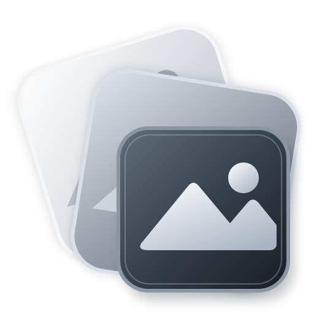

# Carimbo em Lote

Aplica uma logo em um lote de fotos e exporta tudo em um `.zip`, direto no navegador.

**Abrir a aplicação:** https://carimbo.hebertdaniel.com.br/

## O que faz

- Posiciona a logo arrastando na prévia ou por 9 pontos prontos; tamanho e posição são proporcionais, então valem para fotos de formatos diferentes.
- Ajusta tamanho, margem, opacidade, modo de mesclagem, cor (original, branca, preta ou personalizada), saturação e sombra; também gira e espelha a logo, recorta as bordas e aplica formatos (círculo, quadrado, triângulo etc.).
- Permite uma posição própria em fotos específicas do lote.
- Exporta em JPG, PNG ou WebP, com qualidade e redimensionamento opcionais.
- Salva predefinições (logo + ajustes) no navegador, com exportação e importação em arquivo.

As fotos são processadas no próprio navegador e não são enviadas a nenhum servidor.

## Estrutura

Um único arquivo, `index.html`, sem dependências nem etapa de build. Para usar offline, basta abrir o arquivo no navegador.

## Autor

Criado por [@hebert_daniel.73](https://www.instagram.com/hebert_daniel.73/).
